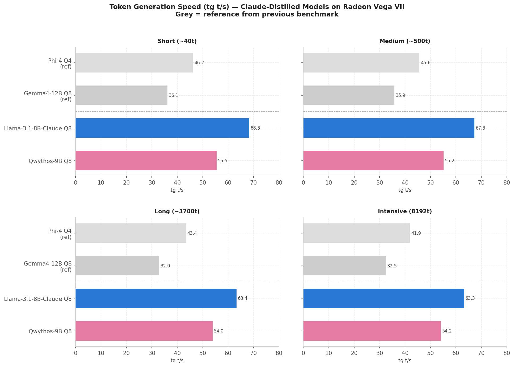
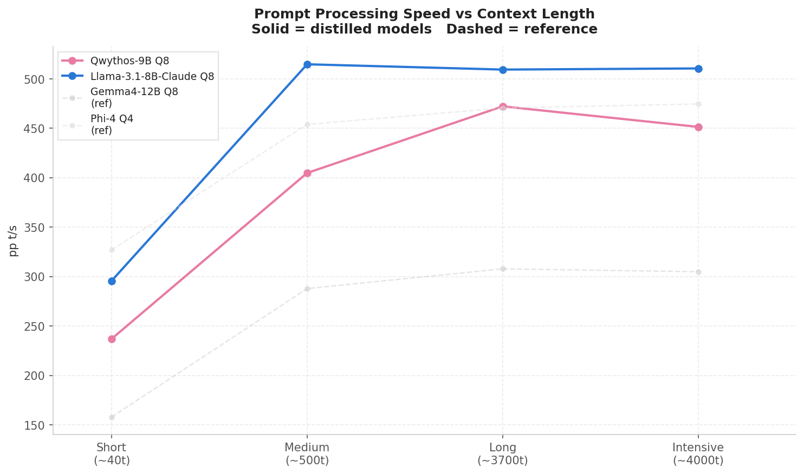
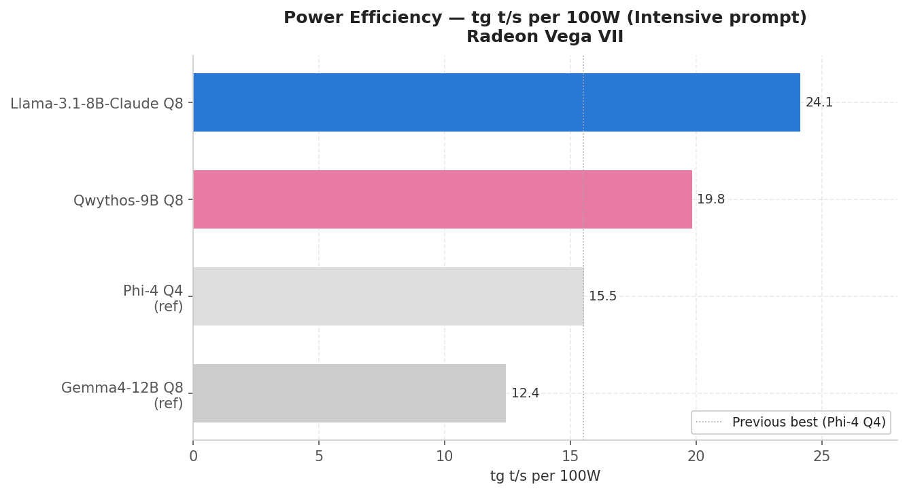
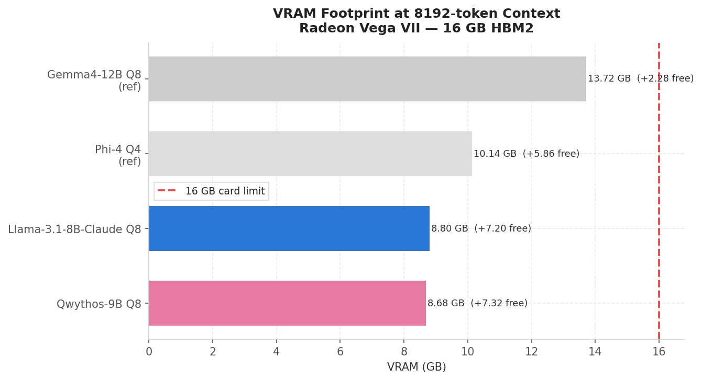

# Claude in a Box: Running Two Claude-Distilled Models on a Radeon Vega VII

> *Testing two models fine-tuned on Claude's responses (Meta-Llama-3.1-8B-Claude and Qwythos-9B) on a 16GB HBM2 Radeon Vega VII.*

---

Claude is a closed model. You can't download it, you can't run it locally, and every token it generates goes through Anthropic's servers. That's fine for most use cases, but if you're running a local inference stack on your own hardware, it sits outside what you can actually use.

What you can do is run models that were trained on Claude's outputs. The idea is straightforward: if you expose a smaller open model to enough examples of how Claude reasons, structures arguments, and approaches problems, some of that style should transfer. The result is what people call a distilled model, not Claude, but something shaped by it.

This post tests two of them on the same Radeon Vega VII from the previous benchmark, under the same conditions, with the same prompt battery. The question isn't whether they're good models, they are. The question is whether any of Claude actually survived the process, or whether "Claude-distilled" is mostly a marketing label on top of a well-trained base model.

One thing worth naming upfront: these models were built using Claude's outputs as training data, which technically violates Anthropic's Terms of Service. That doesn't affect you as someone running local inference, you're just executing a GGUF file. But it's part of the story and worth being honest about rather than glossing over.

---

## Setup

The hardware and software stack is identical to the previous benchmark, same Radeon Vega VII, same llama.cpp compiled from source with `GPU_TARGETS=gfx906`, same ROCm 6.4. If you haven't read that post and want the full compilation process including the problems and fixes, it's all documented in the previous setup post.

The one difference worth noting: both models in this post use standard architectures, Llama 3.1 and Qwen3.5, that are fully supported in llama.cpp's main branch. No fork required, no special flags beyond the usual HIP backend setup. Download, load, run.

---

## The models

Before getting into the numbers, here's what each one actually is.

### Meta-Llama-3.1-8B-Claude

This one is a fine-tune of Meta's Llama 3.1 8B base model, published by bartowski, trained to replicate Claude's conversational and reasoning style. Llama 3.1 8B is the most battle-tested architecture in the llama.cpp ecosystem, wide support, well-understood behavior, no surprises. At Q8_0 it sits at around 8.5GB, leaving over 7GB free for KV cache on a 16GB card.

### Qwythos-9B-Claude-Mythos-5-1M

And for this one we have a full-parameter fine-tune of Qwen3.5 9B developed by Empero AI, trained on over 500 million tokens of reasoning traces from Claude Mythos and Claude Fable. The Mythos part is worth pausing on, Claude Mythos Preview is not a publicly available model. It currently exists only within Anthropic's Project Glasswing, accessible to a small number of trusted organizations. Whether Empero AI had legitimate access as a Glasswing participant or is using the name more loosely than the claim implies is something the model card doesn't clarify. The context window is extended to 1M tokens via YaRN rope scaling. At Q8_0 it weighs 9.53GB.

Both fit comfortably on the Vega VII's 16GB of HBM2 with meaningful headroom for context.

#### A quick note on what didn't make it into this post:
The original plan included Qwen3.5-27B-Claude-Opus and Qwen3-30B-A3B as a MoE comparison. Both crashed with the same rocBLAS TensileLibrary error on gfx906 that's documented in the setup post. The pattern is consistent, models based on the Qwen3.5 architecture above roughly 9B parameters hit a code path that triggers the rocBLAS failure on this GPU. The two models that made it through are the ones that stayed below that threshold.

---

## Methodology

Same protocol as the previous benchmark. Each model was tested with four prompt types: short (~40 tokens), medium (~500 tokens), long (~3,700 tokens), and an intensive prompt covering six different skill areas (reasoning, coding, problem solving, storytelling, and more), with 3 runs per prompt type to calculate the averages. All runs used `--seed 42` and `--temp 0` for full reproducibility. Performance prompts used a fixed output length to keep generation t/s comparable; the intensive prompt was given a generous token budget.

This post adds a fifth prompt: the style probe. Unlike the others, it isn't run three times, it's a single qualitative test designed to reveal whether Claude's reasoning patterns transferred to each model. The prompt describes a nuanced interpersonal situation and asks for structured step-by-step reasoning. The output is evaluated by hand, not by metrics. That section has its own writeup further down.

---

## Results

### Token generation speed (tg t/s)

The first thing the numbers make clear is that both 8-9B models in Q8_0 are in a completely different performance tier than the 14B models from the previous benchmark. The Llama-3.1-8B-Claude peaks at 68.31 t/s on the short prompt and sustains 63.26 t/s through the full intensive run. The Qwythos-9B holds a consistent 55.46 t/s across all prompt lengths with almost no drop-off, a stability that stands out.

For reference, Phi-4 Q4_K_M was the fastest model in the previous benchmark at 46.21 t/s on the short prompt. Both distilled models here beat that comfortably, and they do it at Q8_0 precision, not Q4.

| Model | VRAM | Max Temp | Max W | Short tg | Medium tg | Long tg | Intensive tg |
| :--- | :--- | :--- | :--- | :--- | :--- | :--- | :--- |
| **Qwythos-9B-Mythos Q8_0** | 8.68 GB | 72°C | 273W | 55.46 | 55.16 | 53.96 | 54.16 |
| **Meta-Llama-3.1-8B-Claude Q8_0** | 8.80 GB | 76°C | 262W | 68.31 | 67.34 | 63.35 | 63.26 |
| **Gemma4 12B Q8_0 (ref)** | 13.72 GB | 80°C | 261W | 36.11 | 35.85 | 32.94 | 32.47 |
| **Phi-4 Q4_K_M (ref)** | 10.14 GB | 79°C | 270W | 46.21 | 45.65 | 43.35 | 41.93 |

---

### Prompt processing speed (pp t/s)

Both models scale cleanly with context length. The Llama-3.1-8B-Claude is notably faster at prompt processing than the Qwythos at short contexts (295 vs 237 t/s on the short prompt), but both converge as context grows, by the long prompt, the gap narrows considerably. The Qwythos hits 472 t/s on the long and intensive prompts, matching or exceeding several 14B models from the previous benchmark.

| Model | Short pp | Medium pp | Long pp | Intensive pp |
| :--- | :--- | :--- | :--- | :--- |
| **Qwythos-9B-Mythos Q8_0** | 237.08 | 404.86 | 472.26 | 451.49 |
| **Meta-Llama-3.1-8B-Claude Q8_0** | 295.78 | 514.81 | 509.46 | 510.62 |
| **Gemma4 12B Q8_0 (ref)** | 158.04 | 287.96 | 307.92 | 305.00 |
| **Phi-4 Q4_K_M (ref)** | 327.09 | 454.03 | 470.60 | 474.64 |

---

### Power efficiency

This is where the 8-9B models make their strongest case. Running at under 275W peak with token generation north of 54 t/s, both outperform everything in the previous benchmark on a per-watt basis and by a significant margin.

| Model | Max W (intensive) | tg t/s | tg per 100W |
| :--- | :--- | :--- | :--- |
| **Meta-Llama-3.1-8B-Claude Q8_0** | 262W | 63.26 | **24.1** |
| **Qwythos-9B-Mythos Q8_0** | 273W | 54.16 | **19.8** |
| **Phi-4 Q4_K_M (ref)** | 270W | 41.93 | 15.5 |
| **Gemma4 12B Q8_0 (ref)** | 261W | 32.47 | 12.4 |

The Llama-3.1-8B-Claude at 24.1 t/s per 100W is the most efficient model tested on this hardware across both benchmarks, and it does it at maximum quantization precision.

---

### Thermal behavior

Both models run notably cooler than the 14B models from the previous benchmark. The Qwythos peaked at 72°C on the intensive run, the Llama-Claude at 76°C, compared to the 79-80°C range that most 14B models hit under the same conditions. Less heat, less throttling risk, more headroom.

---

### One failure to document

The Qwythos entered a full loop during SQL problem 3 of the intensive prompt, the stored procedure cursor exercise. It generated repetitive output without recovering, requiring a manual stop. The Llama-Claude handled the same section cleanly. This is the second time a model has failed specifically on that exercise, after Qwen2.5-Coder Q4_K_M in the previous benchmark, though that was a different model architecture and quantization. Worth noting that outside of that one section, the Qwythos completed the intensive prompt without other issues.

---

## The Style Probe. Did the Distillation Work?

The style probe was designed to do one thing: reveal whether these models think like Claude when pushed toward structured reasoning on a nuanced interpersonal problem. Not whether they give good advice, that's easy, but whether the shape of their reasoning matches Claude's characteristic approach: step-by-step breakdown, multiple perspectives held simultaneously, empathetic framing without being vague, and a practical conclusion that doesn't hedge everything into meaninglessness.

Here's what each one did.

### Meta-Llama-3.1-8B-Claude

Seven numbered points covering: pattern recognition, interpretation of plausible excuses, emotional validation, the value of the friendship, a five-part communication framework, boundary-setting, and notably, a self-reflection prompt asking whether something in the user's own life might be amplifying the sensitivity. That last point is distinctly Claude. It's the kind of move that refuses to frame the situation as entirely the friend's problem, offering a more honest, balanced lens. The tone is warm but not effusive. No padding. Ends with a clear framing: a good friend will work on this, but be prepared to advocate for yourself.

It reads like Claude. Not a simulation of Claude, more like a slightly older, more methodical cousin. The structure is there, the epistemic humility is there, and crucially there's no branding overhead.

### Qwythos-9B-Claude-Mythos-5-1M

Starts with: *"Hello. I am Qwythos, an AI model created by Empero AI."* That's the ceiling of what we can say about system prompt contamination, it's hardcoded, it's unavoidable with this GGUF as shipped, and it colours the entire interaction whether you want it to or not.

Past that, the response itself is genuinely good. Five steps with clear headers, an immediate reframe toward external factors (job stress, family issues, health concerns) before assuming bad intent, which is very much a Claude move. The standout element is the specific dialogue the model writes out: *"I've noticed we've had a few last-minute cancellations lately, and I've been feeling a bit hurt. Is everything okay on your end?"* That's the most actionable thing either model produced, and the most emotionally precise. Then three concrete paths forward depending on the friend's response. Clean, practical, genuinely useful.

### The honest verdict

Both pass. Neither sounds generic. The reasoning patterns are there in both: structured breakdown, charitable reading of the other person, emotional validation before practical advice, clear next steps. If you stripped the branding from the Qwythos response and ran both through a blind test, most people would have difficulty picking which one came from a Claude-distilled model and which came from the base Llama fine-tune.

The main practical difference is the identity overhead on the Qwythos. The Llama-Claude responds like an assistant. The Qwythos responds like a product. The underlying reasoning quality is comparable, which is either a testament to the distillation on both models or a sign that 8-9B base models are already good enough at this type of task that the Claude fine-tuning is moving things less than the marketing suggests. Probably both.

---

## Analysis

The Llama-3.1-8B-Claude is faster than the Qwythos-9B across every prompt type and by a consistent margin, 68 vs 55 t/s on the short prompt, 63 vs 54 t/s sustained through the intensive run. That's roughly a 20% advantage in generation speed for the Llama architecture on this hardware.

The reason is almost certainly the architecture difference more than the parameter count. Qwen3.5 9B is a slightly larger model, but the gap is too consistent to be explained by size alone. Llama 3.1 is an architecture that llama.cpp and the ROCm HIP kernels have been optimized against for much longer. The Qwen3.5 family is newer and the kernel-level optimizations for it on gfx906 are less mature. What you're seeing in the numbers is partly model size and partly how well each architecture maps to the specific memory access patterns of HBM2 on Vega.

The Qwythos does have one notable characteristic: its tg t/s barely moves across prompt sizes. From 55.46 on the short prompt to 54.16 on the intensive, the drop is less than 2.5%. The Llama-Claude drops from 68.31 to 63.26, still excellent, but a more typical scaling curve. If sustained generation across very long contexts is your priority, the Qwythos's stability is worth noting even if its absolute ceiling is lower.

For prompt processing the story is similar, the Llama-Claude leads at short contexts (295 vs 237 t/s) but both models converge as context length grows. By the long and intensive prompts they're within 40 t/s of each other, with the Llama still ahead but by a smaller margin.

### Quality

The Qwythos has the training advantage on paper: Qwen3.5 is a more modern base than Llama 3.1, and 500 million tokens of Claude reasoning traces is a substantial fine-tuning dataset. In the intensive prompt the gap shows in places: the Qwythos produced more structured section headers, handled the creative writing and philosophical sections with more fluency, and generally felt like a model that had seen more diverse training signal.

The SQL loop in section 3 is the counterweight to that. A model crashing on a stored procedure cursor problem, a textbook SQL exercise, is not a minor quality issue. It's the kind of failure that happens in production, not in controlled tests, and it undercuts the confidence you'd have deploying it for technical work. The Llama-Claude handled the same section without issue.

So the honest quality summary is: the Qwythos is probably the better general reasoner when it works, and the Llama-Claude is the more reliable one when reliability matters. Which of those you care about depends entirely on your use case.

---

## Closing thoughts

They capture something. Not Claude, that would be an overclaim, but something shaped by it. The reasoning structure is there, the epistemic care is there, and neither model gives you the kind of flat, generic responses you'd get from a base model with no fine-tuning. The style probe made that clear enough. Whether that's the Claude traces doing the work or just the quality of the fine-tuning process is a question the benchmark can't fully answer, and probably shouldn't pretend to.

What surprised me more than the style results was the raw performance. Two models running at 55 and 68 t/s in Q8_0 on a GPU from 2019, cooler and more efficiently than anything in the previous 14B benchmark. If you're building a local inference setup and response speed matters as much as quality, the case for a well-distilled 8-9B at full precision is stronger than the model size suggests.

The Qwythos branding is the thing I'd want fixed before using it seriously. The reasoning underneath it is genuinely good, the hardcoded identity overhead is a product decision that works against the model's actual strengths.

If you want the full picture of what this hardware can run, the previous post covers eight 14B models across four quantization levels with the same methodology.