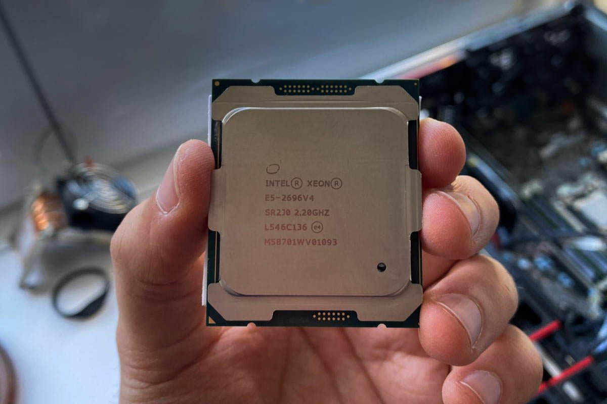
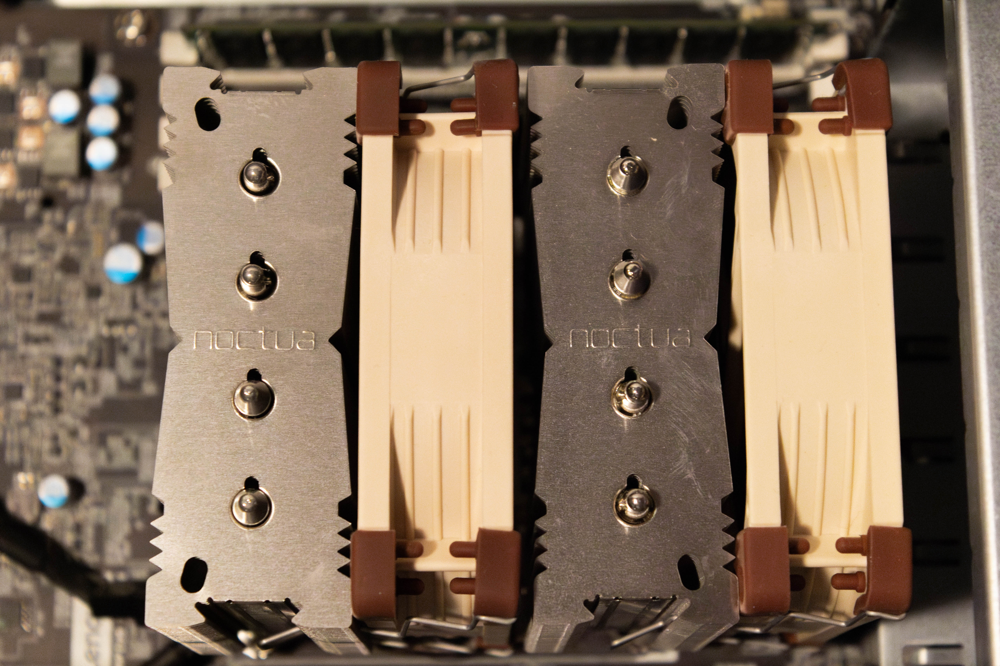
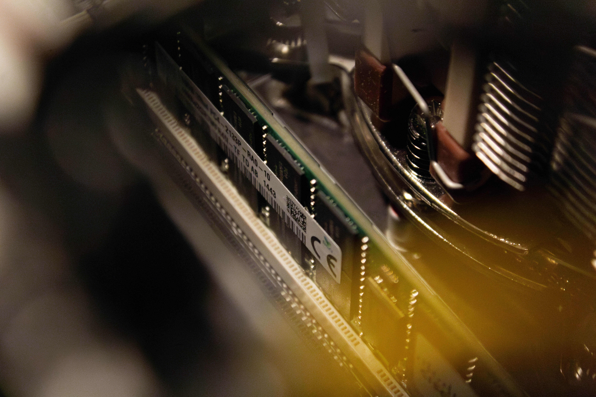
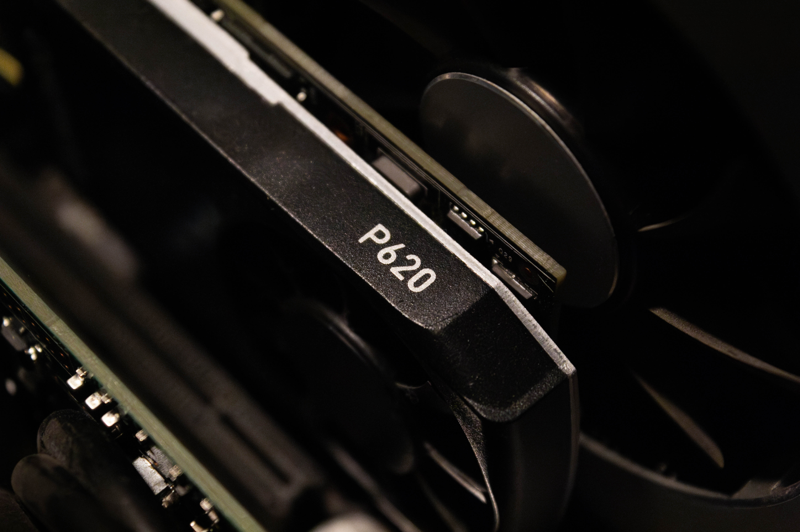
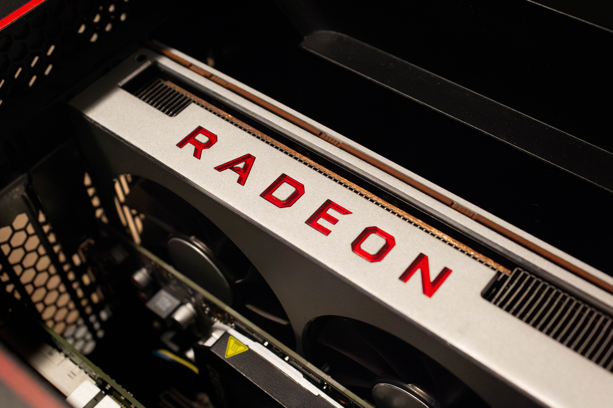
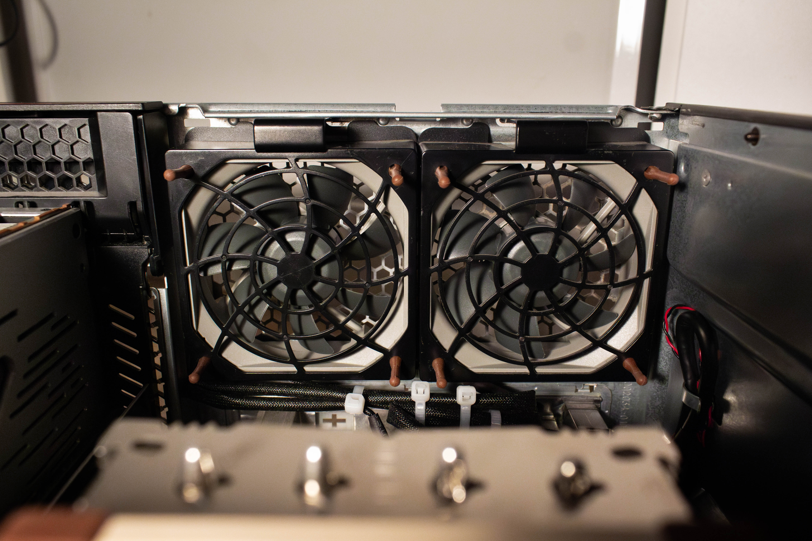

# Upgrading a Lenovo P510 to Run Local LLMs

> *Transforming a second-hand Lenovo P510 workstation into an inference node for local LLMs and Proxmox virtualization.*

---

To begin with, I bought a Lenovo P510 ThinkStation on eBay for roughly 145€, it came with an Intel Xeon E5 1620 V4 (4 cores and 8 threads at 3.5GHz with a turbo frequency of 3.8GHz) and 16GB of DDR4 RAM, no SSD/HDD or GPU included. I upgraded absolutely everything on this machine, I even 3D printed some parts to increase the CPU airflow, so if you want to see which upgrades I did to it, keep reading!

For the CPU upgrade I chose the Intel Xeon E5-2696 V4, it packs 22 cores and 44 threads at a base frequency of 2.2GHz and a turbo frequency of 3.6GHz. It is the second with the most cores behind the E5-2699 V4 and for the 60 euros I paid for it on eBay it seems to me the perfect balance between price and core count and for this system that is going to be dedicated to AI and virtualization that is quite important.

This CPU can get pretty hot (145W) so to cool it off I installed a Noctua NH-D9L that I bought unopened for 40€, it is a compact 3U cooler that uses 92mm fans, it came with one but I added a second one to increase heat dissipation. I ran a stress test on the CPU for 1 hour and the temperatures peaked at 68ºC.

Now, speaking of RAM I bought 64GB of SKHynix DDR4 ECC 2333MHz secondhand for 120€ and yes, I'm still in disbelief on how I was able to score that price in the current crisis that we are going through with memory and storage, although I have to say that I bought them right at the beginning of the crisis when prices were not so bad.

Since Intel Xeons are server processors, they don't have integrated graphics, so I needed a GPU to give image to the system in general, because as I said before, this machine is going to run Proxmox and the AI server is going to be on a virtual machine. After researching old Nvidia architectures and models, I decided to get an Nvidia P620 2GB, after searching for a few days I ended up buying it for 40€ secondhand. With its minimal footprint, 4 mini DisplayPorts and a max power draw of only 40W I think that it is a perfect pick up for any homelab build with similar characteristics.

This was a hard one, at first I was super convinced of getting an RTX 3060 12GB, you could buy one used for 200-250€, incredible value for your money and at first the best budget option for AI. That was until one day I came across a video by [Country Boy Computers](https://www.youtube.com/@CountryBoyComputers), he talked about a 2019 AMD flagship graphics card with 16GB of HBM2 memory, that GPU was the Radeon Vega VII 16GB, there is two important factors here, the obvious one is that 16GB > 12GB, which is significant, with 16GB you can already run pretty decent models for personal use, but the most important one is HBM2 (High Bandwidth Memory 2), this type of memory is providing the GPU with a massive bandwidth of 1.02 TB/s, to put us in perspective the Nvidia RTX 4090 has 1.01 TB/s and it costs x4 more, yes, this AMD GPU costs (at the time I bought it) 250~260€.

Obviously, at raw power there's absolutely no comparison between these two but hear me out, with a power limit of 250W (stock is limited to 300W), running Gemma 4 12B Q8 with the maximum context possible in llama.cpp with ROCm I'm getting an average generation of 39-42 tk/s with lows of ~31 tk/s and max of ~49 tk/s depending on the prompt. I'll make a post talking more in depth about benchmarks and the setup I use to run the models.

<!--  -->

With this I kept it simple, I chose a 10GB SFP+ setup, for this I bought an Intel X520-DA2 on eBay for 25€. I dedicated one of the ports exclusively for the AI server and I'd kept the other one free because in the future I plan to add some HDDs and make a virtual machine for a NAS.

<!--  -->

For storage I chose the 2TB Kioxia Exceria Plus G3 with a read speed of 5000 MB/s, I bought it before the crisis for 121€ (right now it is listed for more than 270€), as the Lenovo P510 does not have M.2 ports I connected it to a M.2 to PCIe adapter and it is working seamlessly.

To improve the PCIe cards zone of the chassis I replaced the original fan from Lenovo with a Noctua NF-A9 (92mm) (A quick note: since Lenovo uses proprietary fan connectors you must cut off one of the plastic guides that come out of a regular fan connector, precisely the one of the middle, I'll put a photo under this text), I can definitely tell the difference between those two. To extract the hot air from the CPU I replaced the two Lenovo fans with two Noctua NF-R8 redux-1800 PWM, they are not the highest performance, but for their price they perform really well and I don't think I would notice the difference with the non-redux ones. 

On the front of the case I replaced the 3.5" bay covers with a 3D printed ones with the same honeycomb pattern that is on the rest of the frontal panel, I leave you the STL [here](https://www.printables.com/model/16261-easy-to-install-pc-35-bay-cover) in case you're interested.
