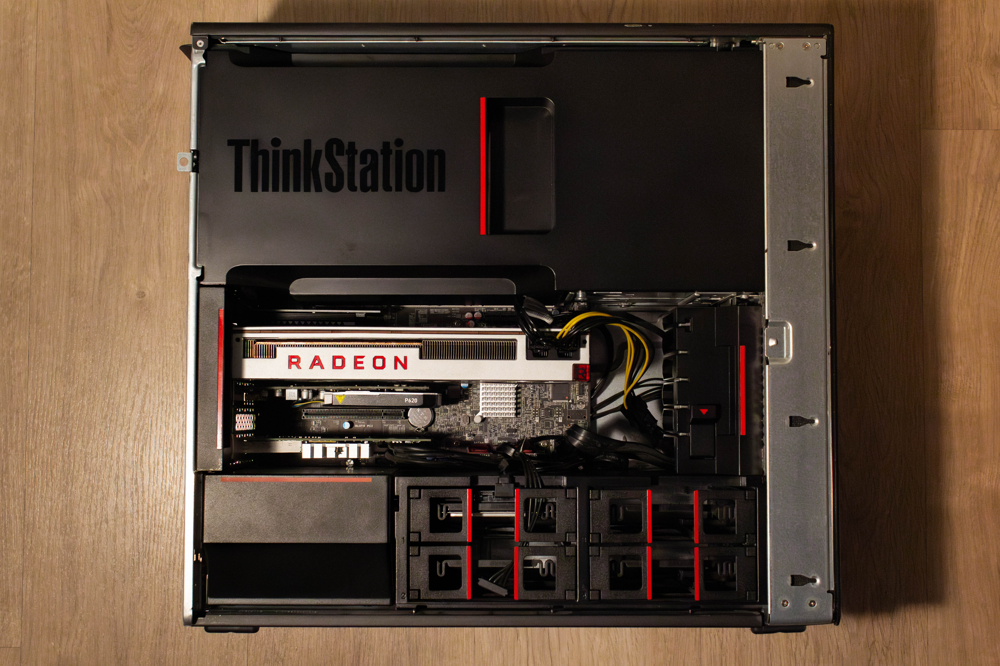
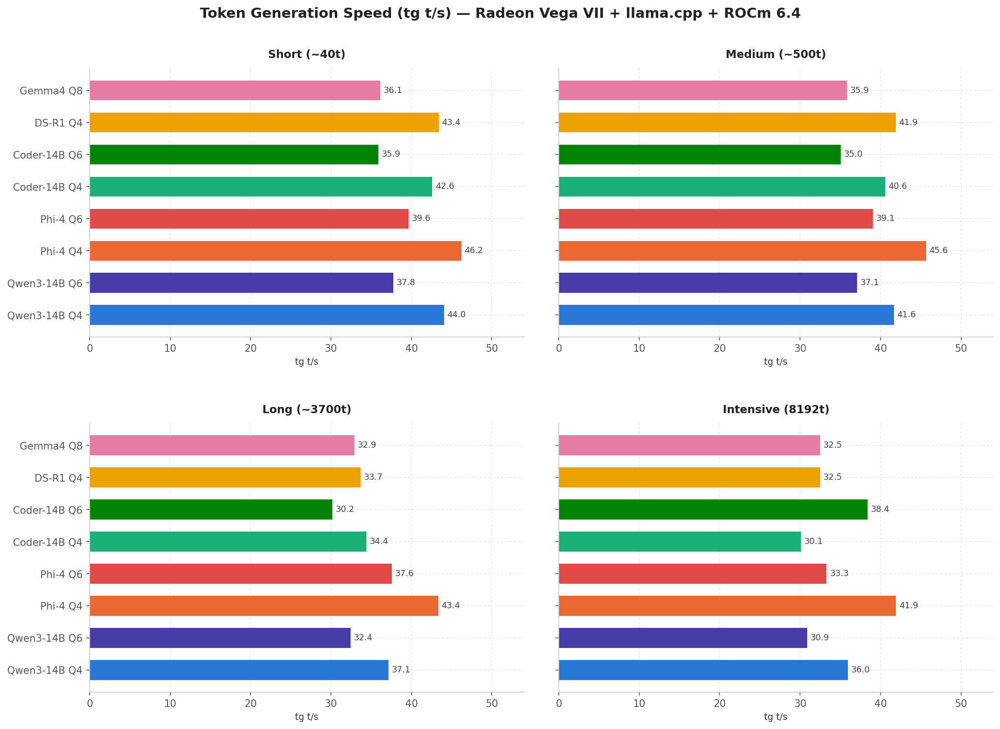
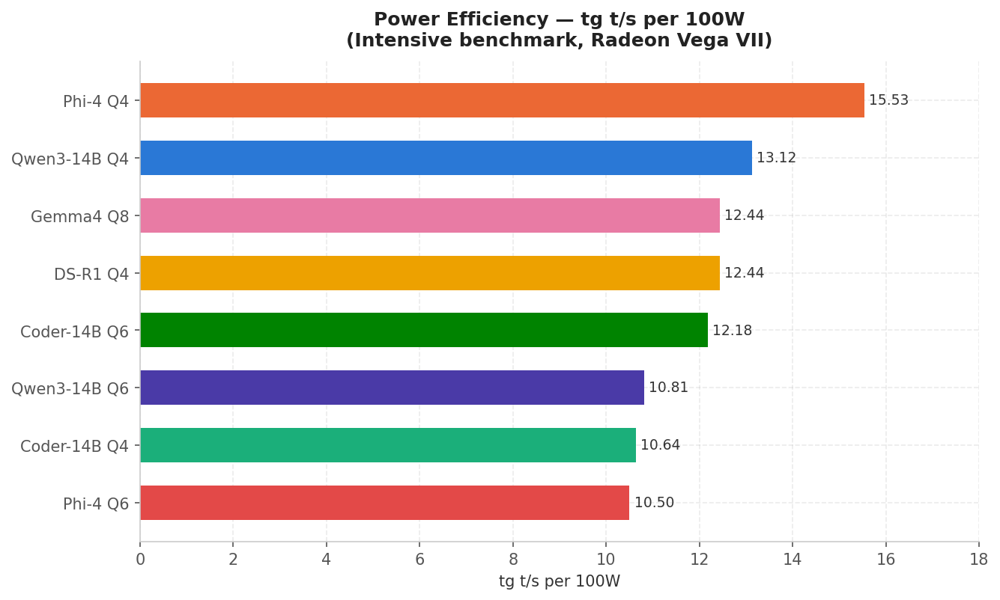
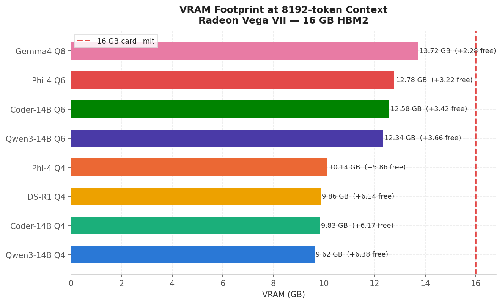

# Radeon Vega VII & llama.cpp: Local LLM Benchmarks on 16GB HBM2

> *Documenting the performance of a 16GB HBM2 legacy GPU running Large Language Models (LLMs) locally.*

---

## Overview

If you've read my previous post you already know this, but if that's not the case here's a little context: I wanted to incorporate into my homelab a machine capable of running LLM models locally with a decent quality and speed on a budget. After months researching what GPU I should buy for this type of build, I finally decided to get a **Radeon Vega VII**, which ROCm keeps in legacy mode. 

Before getting into the software side of things, let's summarize the hardware part:
The Radeon Vega VII is a GPU from 2019 based on the `gfx906` architecture, carrying **16GB of HBM2 memory with a bandwidth of 1.02TB/s**, making it stand out from other GPUs in its price range. 

### My Homelab Setup
* **CPU:** Intel Xeon E5 2696 V4 (22c/44t)
* **RAM:** 64GB DDR4 ECC RAM
* **Storage:** 2TB M.2 NVMe
* **Networking:** Intel X520-DA2 NIC
* **System Graphics:** NVIDIA P620 (leaving the Vega exclusively for AI workloads)
* **AI GPU:** Radeon Vega VII
* **Hypervisor:** Proxmox VE (AI service running inside a dedicated VM)



---

## Software Setup & Compilation

I used `llama.cpp` built from source instead of prebuilt binaries. Why? Because prebuilt binaries simply don't work on `gfx906` with ROCm 6.x.

If you grab the official `llama.cpp` release binary for ROCm and try to run inference on a Radeon VII, you'll hit this crash as soon as the model starts generating text:

```text
rocBLAS error: Cannot read TensileLibrary.dat for GPU arch: gfx906
```

What's happening here is that ROCm 6.x dropped `TensileLibrary` support for `gfx906` in `rocBLAS`. The fix is to compile `llama.cpp` yourself with `GPU_TARGETS=gfx906` set explicitly. This generates native HIP kernels for your exact architecture and completely sidesteps the `TensileLibrary` dependency.

### Installing Dependencies

First, build the base system tools:

```bash
sudo apt update
sudo apt install -y cmake build-essential git libcurl4-openssl-dev
```

Then install ROCm 6.4 via AMD's official installer:

```bash
wget https://repo.radeon.com/amdgpu-install/6.4/ubuntu/noble/amdgpu-install_6.4.60400-1_all.deb
sudo apt install -y ./amdgpu-install_6.4.60400-1_all.deb
sudo amdgpu-install --usecase=rocm --no-dkms
sudo usermod -aG video,render $USER
```

### Compiling llama.cpp

```bash
git clone https://github.com/ggml-org/llama.cpp
cd llama.cpp

HIPCXX="$(hipconfig -l)/clang" HIP_PATH="$(hipconfig -R)" \
cmake -S . -B build \
  -DGGML_HIP=ON \
  -DGPU_TARGETS=gfx906 \
  -DCMAKE_BUILD_TYPE=Release \
&& cmake --build build --config Release -j$(nproc)
```

**Key flags:**
* `-DGGML_HIP=ON`: Enables the HIP/ROCm backend.
* `-DGPU_TARGETS=gfx906`: Compiles kernels specifically for Vega 20 instead of generic ones that crash.

---

## Issues Encountered & Troubleshooting

### 1. Prebuilt binary crashes with TensileLibrary error
* **Fix:** Build `llama.cpp` from source with `GPU_TARGETS=gfx906` as detailed above.

### 2. The amdgpu module doesn't load on boot (Ubuntu 24.04)
* **Fix:** Force module load on system boot:
  ```bash
  echo "amdgpu" | sudo tee /etc/modules-load.d/amdgpu.conf
  ```

### 3. ROCm can't find the GPU (`/dev/kfd` missing)
* **Fix:** Load module manually and set permissions:
  ```bash
  sudo modprobe amdgpu
  sudo usermod -aG video,render $USER
  ```
  *(Log out and log back in for changes to apply).*

### Verifying Installation

Check ROCm GPU recognition:
```bash
rocminfo | grep "gfx\|Marketing"
# Output should show:
# Marketing Name: AMD Radeon VII
# Name:           gfx906
```

Verify `llama.cpp` loaded the HIP backend:
```bash
./build/bin/llama-cli --version
# Look for:
# load_backend: loaded ROCm backend from .../libggml-hip.so
# Device 0: AMD Radeon VII, gfx906:sramecc+:xnack- (0x906), VRAM: 16368 MiB
```

---

## Benchmarking Methodology

I measured **prompt processing speed (pp t/s)**, **token generation speed (tg t/s)**, **VRAM usage**, **peak power draw**, and **max GPU temperature**.

Each model was evaluated across 4 prompt types:
* **Short:** ~40 tokens
* **Medium:** ~500 tokens
* **Long:** ~3,700 tokens
* **Intensive:** ~4,000 to 8,192 tokens (covers reasoning, coding, problem solving, storytelling)

3 runs per prompt type were performed to compute averages, using `--seed 42` and `--temp 0` for complete reproducibility.

### Benchmarked Models Overview

| Model | Quantization | Approx. VRAM |
| :--- | :--- | :--- |
| **Gemma 4 12B** | Q8_0 | ~13 GB |
| **Qwen3-14B** | Q6_K | ~12 GB |
| **Qwen3-14B** | Q4_K_M | ~9 GB |
| **Phi-4 14B** | Q4_K_M | ~9 GB |
| **Phi-4 14B** | Q6_K | ~12 GB |
| **Qwen2.5-Coder-14B** | Q4_K_M | ~9 GB |
| **Qwen2.5-Coder-14B** | Q6_K | ~12 GB |
| **DeepSeek-R1-Distill 14B** | Q4_K_M | ~9 GB |

---

## Benchmark Results

### 1. Token Generation Speed (tg t/s)

Token generation speed represents how fast the model writes its output.



| Model | Quant | Short (~40t) | Medium (~500t) | Long (~3700t) | Intensive (8192t) |
| :--- | :--- | :--- | :--- | :--- | :--- |
| **Phi-4** | Q4_K_M | **46.2 t/s** | **45.6 t/s** | **43.4 t/s** | **41.9 t/s** |
| **Qwen3-14B** | Q4_K_M | 44.0 t/s | 41.6 t/s | 37.1 t/s | 36.0 t/s |
| **DeepSeek-R1** | Q4_K_M | 43.4 t/s | 41.9 t/s | 33.7 t/s | 32.5 t/s |
| **Qwen2.5-Coder** | Q4_K_M | 42.6 t/s | 40.6 t/s | 34.4 t/s | 30.1 t/s |
| **Phi-4** | Q6_K | 39.6 t/s | 39.1 t/s | 37.6 t/s | 33.3 t/s |
| **Qwen2.5-Coder** | Q6_K | 35.9 t/s | 35.0 t/s | 30.2 t/s | 38.4 t/s |
| **Qwen3-14B** | Q6_K | 37.8 t/s | 37.1 t/s | 32.4 t/s | 30.9 t/s |
| **Gemma 4** | Q8_0 | 36.1 t/s | 35.9 t/s | 32.9 t/s | 32.5 t/s |

---

### 2. Prompt Processing Speed (pp t/s)

Prompt processing determines prefill throughput (how fast input tokens are parsed).

| Model | Short (~40t) | Medium (~500t) | Long (~3700t) | Intensive (~4000t) |
| :--- | :--- | :--- | :--- | :--- |
| **Qwen3-14B Q4** | 388.19 t/s | 457.34 t/s | 490.79 t/s | 495.19 t/s |
| **Phi-4 Q4** | 327.09 t/s | 454.03 t/s | 470.60 t/s | 474.64 t/s |
| **Coder-14B Q4** | 276.22 t/s | 431.66 t/s | 478.79 t/s | 313.48 t/s |
| **DS-R1 Q4** | 237.39 t/s | 475.36 t/s | 471.90 t/s | 305.00 t/s |
| **Phi-4 Q6** | 237.27 t/s | 310.84 t/s | 323.44 t/s | 488.97 t/s |
| **Qwen3-14B Q6** | 212.62 t/s | 288.43 t/s | 313.71 t/s | 315.43 t/s |
| **Coder-14B Q6** | 168.96 t/s | 285.25 t/s | 311.41 t/s | 287.00 t/s |
| **Gemma 4 Q8** | 158.04 t/s | 287.96 t/s | 307.92 t/s | 305.00 t/s |

---

### 3. VRAM Footprint & Power Efficiency




#### VRAM Allocation @ 8192 Context
* **Qwen3-14B Q4:** 9.62 GB *(+6.38 GB free)*
* **Coder-14B Q4:** 9.83 GB *(+6.17 GB free)*
* **DS-R1 Q4:** 9.86 GB *(+6.14 GB free)*
* **Phi-4 Q4:** 10.14 GB *(+5.86 GB free)*
* **Qwen3-14B Q6:** 12.34 GB *(+3.66 GB free)*
* **Coder-14B Q6:** 12.58 GB *(+3.42 GB free)*
* **Phi-4 Q6:** 12.78 GB *(+3.22 GB free)*
* **Gemma 4 Q8:** 13.72 GB *(+2.28 GB free)*

#### Power Efficiency (tg t/s per 100W)
1. **Phi-4 Q4:** 15.53 tg t/s / 100W
2. **Qwen3-14B Q4:** 13.12 tg t/s / 100W
3. **Gemma 4 Q8:** 12.44 tg t/s / 100W
4. **DS-R1 Q4:** 12.44 tg t/s / 100W
5. **Coder-14B Q6:** 12.18 tg t/s / 100W
6. **Qwen3-14B Q6:** 10.81 tg t/s / 100W
7. **Coder-14B Q4:** 10.64 tg t/s / 100W
8. **Phi-4 Q6:** 10.50 tg t/s / 100W

---

## Key Takeaways

### What Stood Out
* **Phi-4 Q4_K_M** is the clear efficiency winner: **15.53 tg t/s per 100W** during intensive testing while leading generation speed across almost all prompt types.
* **DeepSeek-R1 Q4_K_M** ran noticeably cooler (max 52°C vs 56–58°C on other models), likely due to lower wattage during chain-of-thought generation phases.

### What Disappointed
* **Qwen2.5-Coder Q4_K_M** encountered an infinite repetition loop during section 4 of the intensive prompt (logical reasoning section). This was the only hard failure across 32 benchmark runs.
* **Phi-4 Q6_K** showed a steep drop in efficiency compared to Q4 (10.5 vs 15.5 tg t/s per 100W), making Q6 hard to justify for daily use on this specific architecture.

---

## Recommendations: Which Model Should You Run?

* **Daily Driver & Large Context:** `Gemma 4 12B Q8_0`
  * *Why:* Offers near-fp16 precision and leaves headroom for up to **~96k context window**. Best option for pasting large files, codebases, and logs.
* **Max Efficiency / Power Savings:** `Phi-4 14B Q4_K_M`
  * *Why:* Best performance-per-watt ratio (15.53 t/s per 100W) and top generation speeds (~42–46 t/s).
* **Coding Workloads:** `Qwen2.5-Coder 14B Q6_K`
  * *Why:* Avoids the Q4 loop issue and maintains critical precision needed for programming tasks.
* **Reasoning / Logic Tasks:** `DeepSeek-R1 Distill 14B Q4_K_M`
  * *Why:* Excellent chain-of-thought capabilities, low power draw, and cool operation.

---

## Limitations & Honest Notes

* **Model Compatibility is Not Guaranteed:** Running a legacy architecture like `gfx906` means future model structures might fail. For instance, **Qwen3.6 24B failed to run** during testing.
* **Ollama is Incompatible:** Ollama does not work out of the box with `gfx906`. Building `llama.cpp` from source is mandatory.
* **Manual Setup Required:** Expect a hands-on experience in the terminal for ROCm drivers, user permissions, and compilation flags.